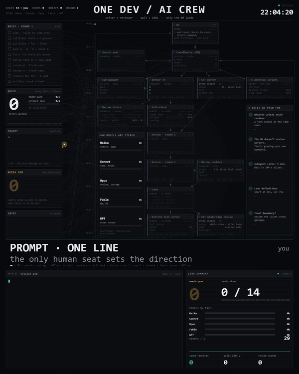

# Multi-Agent Workflow Kit

A small, tool-agnostic starter kit for running a software project with several AI agents:
one manager that dispatches work, cheap seats that search, workers that implement,
independent reviewers, and a narrow tester. It is plain Markdown, so it works with any
AI coding tool that can read a project instructions file and run sub-tasks or parallel
sessions (Claude Code, Codex CLI, Cursor, Gemini CLI, Aider, and others).

Every rule here exists because breaking it cost real money or real bugs on a solo
project built almost entirely by AI agents. The numbers quoted in the rules were
measured from that project's own session logs; treat them as one data point, not a law.

<p align="center">
  
</p>
<p align="center"><sub>One request in the author's own, larger setup, which adds a sub-manager, scripts and a
worker from another vendor, among other things. "GM" is the manager seat and "land" means
merge. That worker ran without commit access, and the tester ran before the reviews; in
this kit, workers commit to their own branch and the tester comes after the reviews
(pipeline step 7).</sub></p>

## Fastest start: Claude Code skill

You don't need to wire anything up by hand. Paste this into Claude Code in your project:

```
Clone https://github.com/WolxsXiftErix/multi-agent-workflow-kit into
~/.claude/skills/multi-agent-workflow (git pull if it is already there), then read its
SKILL.md and follow the Setup section for this repo. Show me every change before you
make it.
```

Claude installs the skill and shows you its plan. Once you say yes, it copies the rules
and the pipeline into `.claude/workflow/`, imports them from `CLAUDE.md`, and adds the
worker, reviewer and tester to `.claude/agents/`. Restart Claude Code once so the agents
load. After that you only describe what you want ("add a settings page", "fix the login
bug"). The main session acts as the manager: it dispatches workers, runs two review rounds
with fresh reviewers, and sends what scripts can't check to the tester. It merges by your
branch rules; if you have none, it asks first. `rules/pipeline.md` spells out each step.

To install it yourself instead:

```
git clone --depth 1 https://github.com/WolxsXiftErix/multi-agent-workflow-kit ~/.claude/skills/multi-agent-workflow
```

In Windows PowerShell:

```
git clone --depth 1 https://github.com/WolxsXiftErix/multi-agent-workflow-kit "$HOME/.claude/skills/multi-agent-workflow"
```

If the folder already exists, run `git pull` inside it instead.

Then tell Claude Code: "set up the multi-agent workflow in this repo".

Install the whole folder, not only `SKILL.md`: Setup reads `rules/`, `agents/` and
`templates/` from next to it, so uploading `SKILL.md` alone as an account skill will not
work.

Other tools can read `SKILL.md` as plain instructions. See "Using it with your tool" below.

## The one iron rule

**The seat that wrote it never reviews it. Neither does the seat that dispatched it.**

Whoever wrote the code checks it against what it meant to write. Whoever handed out the
work checks it against what it expected to get back. Neither is hunting for problems.
Review goes to a fresh seat that gets the code and the diff, not the writer's report.

## The pipeline

```
manager ──> search seat ──> worker ──> review 1 ──> fix ──> review 2 ──> fix ──> merge
 (plans,     (pins files,    (does     (fresh       (by the  (another    (checked   (manager
  dispatches) functions,      exactly   seat, reads  writer)  fresh seat) by a seat  only)
              line numbers    the       the diff)                         that neither
              into the brief) brief)                                      wrote nor
                                                                          dispatched it)
```

- A third review round runs when round 2 still finds a lot.
- Anything scripts cannot check (walking through a real page, judging visuals) goes to a
  separate tester seat that only tests.
- Only the manager merges. Workers commit to their own branch (and push it, if the repo
  has a remote) and report back; nobody else merges.

## Glossary

| Term | Meaning |
|---|---|
| Seat | One agent context: the main session, or one subagent / sub-session. |
| Fork | A copy of an existing context. **A fork counts as the same seat** it came from, even on a different model, because it carries the writer's whole context. |
| Manager | The seat that plans, dispatches, checks artifacts and merges. Usually the main session. |
| Search seat | A cheap seat that locates files, functions and line numbers before work is dispatched. |
| Worker | Implements exactly one brief and runs its own narrow checks. |
| Reviewer | Review-only seat. Reads the diff, reports findings, never edits. |
| Tester | Test-only seat for what scripts cannot check. Reports pass / fail with evidence. |
| Brief | The self-contained task description a seat receives. It is the only context that seat has. |
| Round | One full review pass by a fresh seat, followed by fixes. |

## Files

```
README.md                      this file
SKILL.md                       Claude Code skill: sets up the repo, then runs the pipeline per request
rules/pipeline.md              the step order the manager follows for every request
rules/coordinator-rules.md     the rules the manager follows (put in your project instructions)
agents/worker.md               worker role (Claude Code subagent format; body works as a plain prompt)
agents/reviewer.md             reviewer role
agents/tester.md               tester role
templates/task-brief.md        fill-in brief for a worker
templates/review-prompt.md     fill-in prompt for a reviewer
templates/bounce-back.md       fill-in note for sending work back
docs/demo.gif                  the animation at the top of this file
LICENSE                        MIT
```

## Quick start (by hand)

1. Copy `rules/coordinator-rules.md` and `rules/pipeline.md` into your repo and make your
   tool load them as project instructions (see the per-tool notes below).
2. Copy the three files in `agents/` where your tool looks for role or agent definitions,
   or keep them in the repo and reference them when you start a sub-task.
3. For each piece of work: have a cheap search seat pin the files and line numbers, fill in
   `templates/task-brief.md`, and dispatch one worker per code area. In Claude Code, for
   example: "Use the worker subagent on Sonnet with this brief: ...". Claude Code's
   built-in Explore agent works as the search seat.
4. When the worker reports, check the artifacts (files exist, commit is on the branch)
   before you believe "done".
5. Fill in `templates/review-prompt.md` and give it to a fresh reviewer with the diff.
   Send findings back to the worker with `templates/bounce-back.md`. Repeat for round 2.
6. Merge yourself, from the manager seat only.

## Using it with your tool

These notes stay generic on purpose. Tool features change; check your tool's docs for the
exact file names and commands.

**Claude Code.** The skill above does all of this for you. By hand: put the rules and the
pipeline in `CLAUDE.md` (paste them, or import them with `@rules/coordinator-rules.md` and
`@rules/pipeline.md` lines). Copy `agents/*.md` into `.claude/agents/`; they are
already in the subagent format (frontmatter `name`, `description`, `tools`). The
definitions leave `model` unset, so a subagent inherits the main session's model. Pass a
model on every dispatch, or add `model:` to each file's frontmatter (for example `sonnet`
for worker and tester, `opus` for reviewer).

**Codex CLI.** Put the rules in `AGENTS.md` at the repo root. Use the bodies of the agent
files as role prompts: start a separate session for each seat and paste or reference the
role file plus the filled-in brief.

**Cursor.** Put the rules in your project rules (for example a file under `.cursor/rules/`,
or `AGENTS.md` if your version reads it). Run each seat as its own chat or background
agent, starting it with the role file and the brief.

**Gemini CLI.** Put the rules in `GEMINI.md`. Start each seat as a separate session with
the role file and the brief.

**Aider and others.** Load the rules as a read-only context file (Aider can read
convention files you pass to it), or paste them at the start of each session. Any tool
works as long as you can (a) give a seat a role prompt and a brief, (b) keep the writer
and reviewer in separate contexts, and (c) see the resulting diff.

If your tool cannot spawn sub-tasks at all, run each seat as a separate session or
terminal. The rules still hold: separate contexts, writer never reviews, manager merges.

## Using it with an orchestrator

Orchestrators such as [CAS](https://github.com/codingagentsystem/cas) run the seats for
you: they start several agent sessions, give each worker its own git worktree, and pass
tasks and messages between a supervisor and its workers. This kit does not do that. It is
the set of rules for how those seats are used: who reviews, which model each seat gets,
how long a subagent may sit idle, and what counts as "done". The two can be combined; the
orchestrator's supervisor plays the kit's manager seat.

- Load `rules/coordinator-rules.md` and `rules/pipeline.md` wherever the supervisor reads
  its instructions (for Claude Code-based tools, usually `CLAUDE.md`).
- Use the bodies of `agents/worker.md`, `agents/reviewer.md` and `agents/tester.md` as the
  role prompts for the orchestrator's agents, with an explicit model for each if the
  orchestrator lets you set one.
- If the orchestrator already creates a worktree and branch per worker, that covers the
  own-branch-and-worktree part of pipeline step 3; still make sure each branch starts from the latest main.
- If the supervisor that hands out the work also reviews it before merging, add a separate
  reviewer seat in front of the merge. Under the iron rule, the seat that dispatched the
  work does not review it; the supervisor still merges.
- Keep the cost rules: cheapest tier that can do the job, artifacts checked before "done",
  and no seat that runs as a subagent idle past about 4 minutes. A worker that runs as
  its own session (not a subagent) usually keeps its cache longer; check what your
  provider does.

Check your orchestrator's docs for where it reads instructions and agent definitions;
these differ between tools and versions.

## What this kit is not

- Not a framework, a plugin or a script bundle. There is no code to run. The skill is a
  `SKILL.md` plus the `rules/`, `agents/` and `templates/` folders that Setup copies
  from, all plain Markdown, and you can set everything up by hand instead.
- Not an orchestrator. It does not launch terminals or schedule agents for you; your
  tool's subagents or separate sessions do that, or you can pair it with an orchestrator (see "Using it with
  an orchestrator").
- Not tied to one vendor. Model names in the tier table are examples.
- Not complete. Add your own project rules next to these; keep them short, because every
  agent re-reads them on every request.

## License

MIT. See `LICENSE`.
